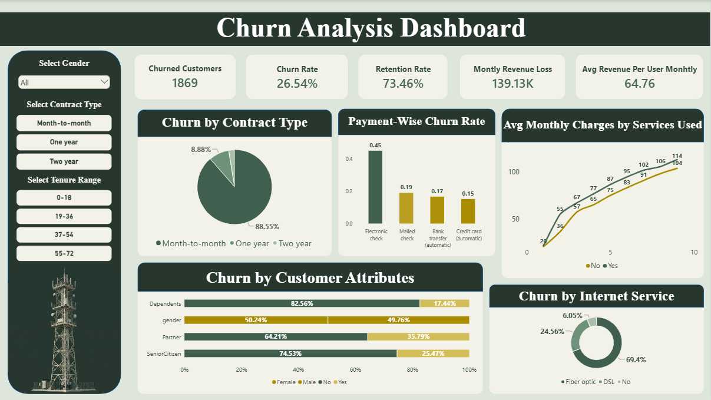

# Customer churn Analysis

An end-to-end data analysis project investigating customer churn patterns for a telecommunications company. This repository contains the complete workflow—from exploratory data analysis (EDA) in Python to an interactive Power BI dashboard designed to uncover actionable business insights and reduce churn rates.

## 🎯 About the Project

Why do customers leave a telecom company, and what patterns can help businesses understand customer churn?

This project explores customer data to identify churn trends, understand customer behaviour, and uncover insights that can support better customer retention strategies.

The analysis combines Python-based data exploration with an interactive Power BI dashboard.

## ✨Project Highlights

- Cleaned and prepared customer data using Python and Pandas.
- Performed Exploratory Data Analysis (EDA).
- Created new analytical features to support deeper analysis.
- Developed 16 KPIs to evaluate customer churn and retention.
- Built an interactive Power BI dashboard with filters.
- Derived actionable insights from customer behaviour and churn patterns.

## 📸 Dashboard Preview

## 🔍 A Few Key Insights

- Overall customer churn rate: 26.54%
- Month-to-month contract churn rate: 42.71%
- Churn rate among customers with 0–18 months of tenure: 44.40%
- Senior citizens had a higher churn rate (41.68%) than non-senior citizens (23.61%).

## 🛠️ Tools & Technologies

- Python
- Pandas
- Jupyter Notebook
- Power BI

## 📂 Repository Contents

├── Analysis/
│   ├── Customer_churn_Insights_and_analysis (Detailed findings & recommendations)
│   └── churn_analysis.ipynb                 (Jupyter Notebook with EDA and modeling)
├── Dashboard/
│   ├── Interactive_dashboard_view.png       (Snapshot of interactive dashboard features)
│   ├── Overall_dashboard_view.png           (Overview snapshot of the Power BI report)
│   └── churn analysis.pbix                  (Power BI interactive report file)
├── Dataset/
│   └── -Telco-Customer-Churn.csv            (Raw dataset)
└── README.md

## 📄 Detailed Project Report

For a complete explanation of the analysis, KPI calculations, findings, and recommendations, refer to the Project Report (PDF) available in this repository.

[View Detailed Project Report (PDF)](Analysis/Customer_churn_Inisghts_and_analysis.pdf)

## 📊 Dataset

Telco Customer Churn Dataset

Source: "Kaggle – Telco Customer Churn" (https://www.kaggle.com/datasets/blastchar/telco-customer-churn)

The dataset contains 7,043 customer records and information about demographics, subscribed services, account details, billing, and churn status.

---

Project Type: Data Analysis
Domain: Telecommunications

Turning Data into Actionable Insights.
